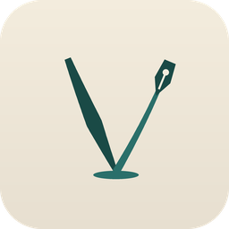
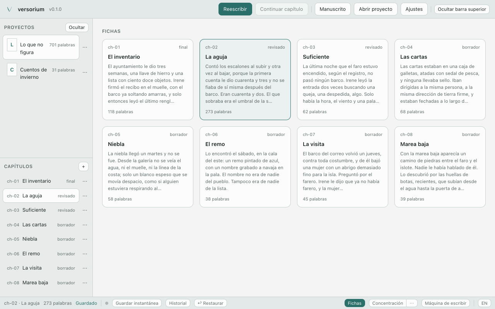
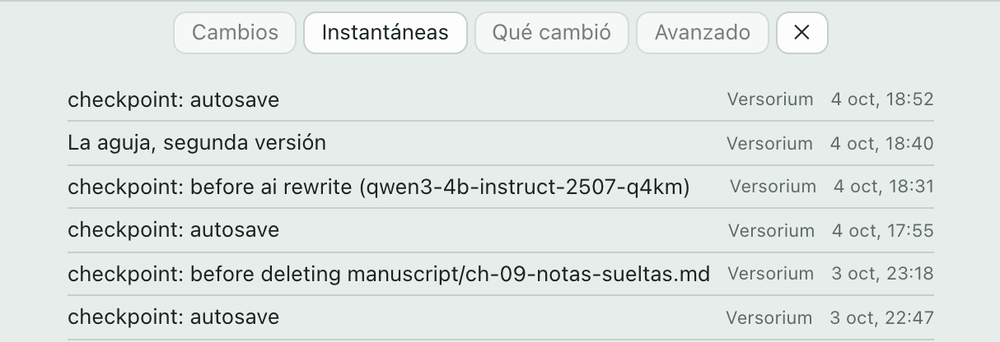
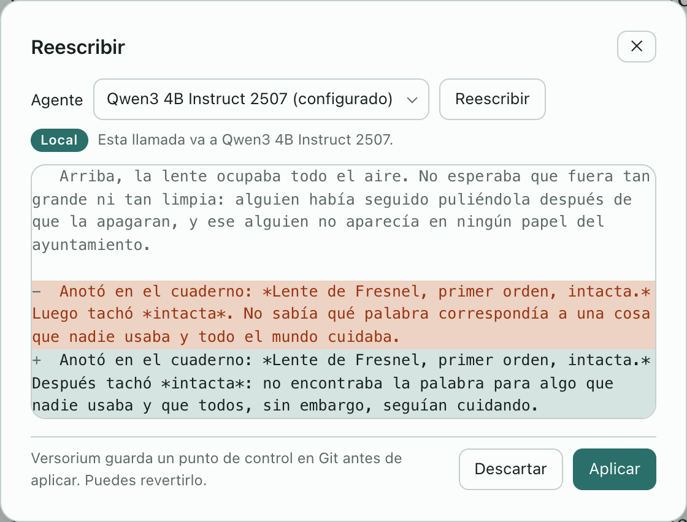

<p align="center">
  <a href="https://versorium.maecly.com/"></a>
</p>

<h1 align="center">Versorium</h1>

<p align="center">
  <b>Escribe tu novela. Cada borrador queda guardado.</b><br>
  Una app para escribir novelas en tu ordenador. Funciona sin conexión, y la IA está apagada hasta que la llames.
</p>

<p align="center">
  <a href="https://github.com/MAECLY/versorium-app/releases/latest"></a>
  <a href="https://github.com/MAECLY/versorium-app/releases"></a>
  <a href="https://github.com/MAECLY/versorium-app/stargazers"></a>
  <a href="https://hits.sh/github.com/MAECLY/versorium-app/"></a>
  <a href="https://github.com/MAECLY/versorium-app/commits/main"></a>
  <a href="LICENSE"></a>
</p>

<p align="center">
  <a href="https://github.com/MAECLY/versorium-app/releases/latest"><b>Descargar</b></a> ·
  <a href="https://versorium.maecly.com/">Web</a> ·
  <a href="https://versorium.maecly.com/comparar/">Comparar</a> ·
  <a href="https://versorium.maecly.com/detalles/">Límites</a> ·
  <a href="#para-desarrolladores">Compilar desde el código</a> ·
  <a href="README.md">English</a>
</p>

<p align="center">
  <sub>Gratis · Sin cuenta · Código abierto · macOS, Windows y Linux · Español e inglés</sub>
</p>

<p align="center">
  <a href="https://versorium.maecly.com/">
    <picture>
      <source media="(prefers-color-scheme: dark)" srcset=".github/readme/es/corkboard-dark.webp">
      
    </picture>
  </a>
</p>

## Por qué Versorium

- **Nada se pierde.** Guarda mientras escribes y hace una instantánea cada
  minuto, antes de que escriba una IA y antes de borrar un capítulo.
- **Tuya, de principio a fin.** Tu novela es una carpeta de archivos Markdown
  que se abren sin Versorium. Sin cuenta, sin telemetría.
- **La IA, solo si la llamas.** Apagada, un modelo en tu ordenador, o el Claude
  Code, Codex u OpenCode que ya usas. Ves cada cambio antes de aplicarlo.

Si Versorium desaparece mañana, tu novela no.

## Descargar

Descarga el archivo para tu ordenador de la
**[última versión](https://github.com/MAECLY/versorium-app/releases/latest)**.
La [web](https://versorium.maecly.com/#descargar) también puede elegirlo por
ti.

| Ordenador | Archivo | Probada |
|---|---|---|
| Mac con Apple silicon, macOS 10.15+ | `.dmg` | Sí (0.1.1) |
| Mac con procesador Intel, macOS 10.15+ | `.dmg` | Todavía no |
| Windows, x64 | instalador `.exe` o `.msi` | Los dos, en Windows 11 (0.1.0), y luego la actualización desde la app a la 0.1.1 |
| Linux, x64 | `.deb`, `.rpm` o `.AppImage` | El `.deb`, en Ubuntu 22.04 (0.1.0) |

Cada versión incluye un archivo `SHA256SUMS`. Para enterarte de las próximas:
**Watch → Custom → Releases** en esta página, o el
[feed RSS](https://github.com/MAECLY/versorium-app/releases.atom).

> [!WARNING]
> Las versiones todavía no están firmadas con un certificado de Apple ni de
> Microsoft, así que macOS y Windows te avisan la primera vez. Sigue estos
> pasos solo con un archivo descargado de la página de versiones (Releases)
> de este repositorio.

<details>
<summary><b>macOS dice que la app está dañada.</b> No lo está.</summary>

<br>

macOS pone en cuarentena las apps sin Apple Developer ID. Mueve Versorium a
Aplicaciones y quita la marca una vez, en Terminal:

```bash
xattr -rd com.apple.quarantine /Applications/Versorium.app
```

Esa marca es la comprobación que te protege de una descarga manipulada.

</details>

<details>
<summary><b>Windows muestra «Windows protegió su PC».</b></summary>

<br>

Elige **Más información** y luego **Ejecutar de todas formas**. Versorium
necesita un procesador x86-64-v2 (SSE4.2) y Vulkan (`vulkan-1.dll`, que se
instala normalmente con los controladores gráficos); en un PC sin controladores
Vulkan no se ha probado.

</details>

<details>
<summary><b>Linux</b></summary>

<br>

Marca el AppImage como ejecutable (`chmod +x`) si tu gestor de archivos no lo
ha hecho. El `.deb` depende de `libvulkan1` y `libssl3`. Versorium necesita un
procesador x86-64-v2 (SSE4.2).

</details>

## Nada se pierde

Versorium guarda mientras escribes. Cada minuto si algo cambió, antes de que la
IA escriba nada y antes de borrar un capítulo, hace una instantánea. ¿Borraste
una frase en esta sesión? **↩ Restaurar** la devuelve de una vez.

Las instantáneas son commits de Git, hechos con el Git que la app lleva dentro:
no tienes que instalarlo, ni saber usarlo para escribir.

<p align="center">
  <picture>
    <source media="(prefers-color-scheme: dark)" srcset=".github/readme/es/history-dark.webp">
    
  </picture>
</p>

> [!NOTE]
> Volver a una instantánea antigua requiere Git, por ahora. La app todavía no tiene pantalla para eso.

## Tuya, de principio a fin

- **Una carpeta en tu disco.** Un archivo Markdown por capítulo, con las
  escenas como encabezados `##`.
- **Un registro de quién escribió qué.** Cada inserción y cada borrado quedan
  anotados en la carpeta de la novela con su autor: tú, o la IA que lo hizo.
- **Respaldos de los que fiarte.** Un clic escribe un zip de toda la novela,
  con su historial, en hasta tres carpetas. Cada zip se vuelve a leer y se
  comprueba, y al restaurar se descomprime junto a tu novela, nunca encima.
- **Sin cuenta, sin telemetría.** Por su cuenta, la app solo busca
  actualizaciones, una vez al abrirse y sin nada de tu novela, y se desactiva
  en Ajustes → Aplicación. Solo instala una actualización si su firma coincide
  con la clave que lleva dentro y su SHA-256 con el `SHA256SUMS` de la
  versión; actualizar desde la app se ha probado de principio a fin, de la
  0.1.0 a la 0.1.1, en un Mac con Apple silicon y en Windows 11.

## La IA, solo si la llamas

Está apagada hasta que elijas una, y no escribe nada sin tu permiso. Cada
reescritura te enseña el cambio antes, y Versorium hace una instantánea antes
de aplicarlo.

| Nivel | Qué se usa | Adónde va tu pasaje |
|---|---|---|
| **Apagada** | Nada | A ningún sitio |
| **En tu ordenador** | Un modelo dentro de la app (llama.cpp, 11 modelos de escritura, que solo se descargan si lo pides), Ollama o un servidor local como LM Studio | Se queda en tu ordenador. Un servidor que apunte a otra máquina se marca como Red |
| **Tu herramienta** | El Claude Code, Codex u OpenCode que ya tienes instalado y con tu sesión. Solo Reescribir | Al servicio de esa herramienta |

Hoy la IA reescribe pasajes y, con un modelo en tu ordenador, revisa la
continuidad. Versorium también es un [servidor MCP](#mcp), así que los
asistentes que ya usas pueden leer tu manuscrito, en solo lectura salvo que
permitas más.

<p align="center">
  <picture>
    <source media="(prefers-color-scheme: dark)" srcset=".github/readme/es/rewrite-dark.webp">
    
  </picture>
</p>

## Una mesa para escribir

| Función | Qué hace |
|---|---|
| **Fichas** | Toda la novela de un vistazo, una ficha por capítulo |
| **Concentración y Máquina de escribir** | Solo tú y la página; la línea que escribes se queda en el tercio inferior |
| **Reescribir** | Ves cada cambio antes de aplicarlo |
| **Temas** | Folio, Quarry y Needle, cada uno claro y oscuro (las imágenes de aquí son Needle) |
| **Escritura** | Corrector ortográfico, tamaño y ancho del texto, plantillas, español e inglés |
| **Exportar** | DOCX con formato de manuscrito, EPUB 3, PDF, Markdown y Scrivener |
| **Importar** | Markdown, DOCX, EPUB y Scrivener, con una vista previa antes de crear nada |

## Lo que todavía no hace

Versorium está empezando, y lo dice claro:

- La IA solo reescribe pasajes y revisa la continuidad. La continuidad lee los
  títulos de los capítulos, los encabezados de escena y las primeras líneas
  de tus fichas del Codex, no tus capítulos, y solo funciona con un modelo que ejecutas tú
  (en la app, Ollama o un servidor local), no con Claude Code, Codex u
  OpenCode. No hay chat.
- Volver a una instantánea requiere Git, y los respaldos se hacen a mano.
- El corrector usa el del sistema: funciona en macOS y en Windows, y en Linux
  todavía no subraya nada.
- Al importar de Word, EPUB o Scrivener se pierden negritas, cursivas y
  escenas.
- Aún sin probar: los Mac Intel, el `.rpm`, el AppImage y ninguna versión
  posterior a la 0.1.0 en Linux.
- Las versiones no están firmadas (mira arriba).

Todos los límites conocidos, con lo que se probó y lo que no, están en la
[página de detalles](https://versorium.maecly.com/detalles/#limites).

## Cómo se compara

Versorium es gratis, funciona sin conexión y sin cuenta, guarda tu novela en
tus propios archivos Markdown con una instantánea cada minuto, y te deja elegir
tu IA o ninguna. Otras van por delante en sincronizar dispositivos, escribir
con otras personas, apps para el móvil y volver a una versión desde la propia
app.

La [comparación completa](https://versorium.maecly.com/comparar/) con Dabble,
Notion, Novelcrafter, Scrivener y Sudowrite da precios y fuentes, con fecha.

## Preguntas

<details>
<summary><b>¿Mi novela sale de mi ordenador?</b></summary>

<br>

Solo si tú lo pides: al enviarla a GitHub, al reescribir con una herramienta
externa o con un servidor en otra máquina, al dejar que un asistente la lea por
MCP o al respaldarla en una carpeta que se sincroniza. Por su cuenta, la app
solo busca actualizaciones, sin nada de tu novela, y puedes desactivarlo.

</details>

<details>
<summary><b>¿Necesito una cuenta o saber Git?</b></summary>

<br>

Cuenta, no: no hay registro. Git, tampoco para escribir: Versorium hace las
instantáneas por ti con el Git que lleva dentro. Por ahora solo hace falta para
volver a una antigua.

</details>

<details>
<summary><b>¿Qué IA usa?</b></summary>

<br>

Ninguna hasta que elijas una: un modelo dentro de la propia app, Ollama o un
servidor local, o Claude Code, Codex u OpenCode, que envían el pasaje a su
propio servicio.

</details>

<details>
<summary><b>¿Puedo traer mi novela de Scrivener o Word?</b></summary>

<br>

Sí: importa Scrivener, DOCX, EPUB y Markdown, y te enseña una vista previa
antes de crear nada. Desde DOCX, EPUB o Scrivener se pierden negritas,
cursivas y escenas.

</details>

<details>
<summary><b>¿Por qué es gratis?</b></summary>

<br>

Es código abierto (AGPL-3.0) y lo hace una persona. No hay versión de pago ni
anuncios, y la app no recoge datos.

</details>

## Por qué existe

> Hice Versorium para mí. Quería escribir con calma, sin miedo a perder lo escrito, y usar la IA a mi manera o no usarla. Las apps que probé se quedaban cortas para una novela o cobraban de más. Por eso es gratis y de código abierto: tu novela vive en una carpeta tuya, cada cambio queda guardado y la IA (la que ya pagas, una en tu ordenador o ninguna) solo entra cuando la llamas. Y la sigo mejorando.
>
> — Miguel Angel Esparza Calero, [maecly.com](https://www.maecly.com/about)

## Contribuir

No hace falta programar para ayudar.

- **Pruébala en un Mac Intel, o el `.rpm` o el AppImage en Linux**, y
  [abre una incidencia](https://github.com/MAECLY/versorium-app/issues)
  contando qué pasó.
- **Informa de un fallo** desde la propia app: en Ajustes, el registro de
  fallos tiene **Informar** y luego **Abrir una incidencia**, que abre una
  incidencia ya rellenada en tu navegador, sin texto de tu novela.
- **Mejora el español o el inglés** en [`locales/`](locales).
- **Envía un arreglo.** Lee [CONTRIBUTING.md](CONTRIBUTING.md) (en inglés) y
  acepta el [Acuerdo de Licencia de Contribuidor](CLA.md); conservas los
  derechos de autor de lo que escribas. Pasa `make verify` antes de abrir el
  pull request.

Lo que viene después está en [docs/project/TODO.md](docs/project/TODO.md) (en
inglés). Si Versorium te sirve, una estrella ayuda a que otros escritores la
encuentren.

## Para desarrolladores

**Tecnología:** Tauri 2 · Rust · Svelte 5 · CodeMirror 6 · libgit2 · llama.cpp

Necesitas Rust estable, Node `^20.19` o `>=22.12`, pnpm (fijado en
`package.json`) y cmake con un compilador de C/C++, porque llama.cpp se compila
desde el código. En Linux, además, los paquetes que instala la CI (están en
[`ci.yml`](.github/workflows/ci.yml)).

```bash
pnpm install
make dev PNPM=pnpm             # la app de escritorio, con recarga en caliente
make mock PNPM=pnpm            # la interfaz en el navegador, con el backend simulado
make verify PNPM=pnpm          # todas las comprobaciones: tipos, idiomas, UI, Rust, clippy, end-to-end
pnpm tauri build --no-sign     # instaladores, sin la clave del actualizador del mantenedor
```

<details>
<summary><b>Notas para Windows y para las pruebas end-to-end</b></summary>

<br>

El Makefile necesita un shell POSIX y por defecto usa el pnpm de Homebrew en
Apple silicon; de ahí `PNPM=pnpm`. En Windows, ejecuta los scripts
directamente: `pnpm tauri dev`, y luego `pnpm check`, `pnpm locales`,
`pnpm test:ui`, `pnpm test:e2e`, y `cargo test` /
`cargo clippy --all-targets -- -D warnings` en `src-tauri/`. Las pruebas
end-to-end usan Google Chrome; define `PLAYWRIGHT_CHANNEL` para usar otro
navegador de Playwright. `make help` lista todos los objetivos.

</details>

### MCP

El propio binario de Versorium es un servidor MCP por stdio, **de solo lectura
por defecto**. Ajustes → Acceso a tu novela conecta por ti Claude Code, Claude
Desktop, Codex y OpenCode, y muestra el comando exacto. Escribir requiere un
permiso por cliente. Una escritura sin `confirm: true` solo devuelve una vista
previa del cambio, y la que se aplica va precedida de una instantánea de Git y
queda anotada a nombre del cliente. Un
transporte HTTP opcional está apagado por defecto y solo escucha en
`127.0.0.1`.

### Documentación

| Lee | Para |
|---|---|
| [docs/project/REFERENCE.md](docs/project/REFERENCE.md) | La referencia para desarrolladores (en inglés): las reglas del proyecto, los comandos, los agentes, las herramientas MCP y cómo queda una novela en disco |
| [AGENTS.md](AGENTS.md) | Cómo está organizado el código y qué convenciones sigue |
| [docs/project/](docs/project/) | La especificación, el sistema de diseño, el estado, la lista de pendientes y cómo se publica una versión |
| [MAECLY/versorium-app-landing](https://github.com/MAECLY/versorium-app-landing) | La web, [versorium.maecly.com](https://versorium.maecly.com/) |

## Licencia

Versorium es software libre bajo la
[GNU Affero General Public License v3.0](LICENSE). Las contribuciones se
aceptan bajo el [CLA](CLA.md). El nombre, el logotipo y la marca pertenecen a
MAECLY y esa licencia no los cubre; ver [TRADEMARKS.md](TRADEMARKS.md).
Licencias de terceros incluidas:
[THIRD-PARTY-NOTICES.md](THIRD-PARTY-NOTICES.md). Para una licencia comercial,
escribe a hola@maecly.com.

<p align="center">
  <sub><em>Un escritorio tranquilo, una aguja fina.</em><br>
  Hecha por <a href="https://www.maecly.com/about">Miguel Angel Esparza Calero</a> · <a href="https://versorium.maecly.com/">versorium.maecly.com</a></sub>
</p>
