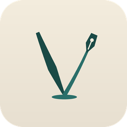
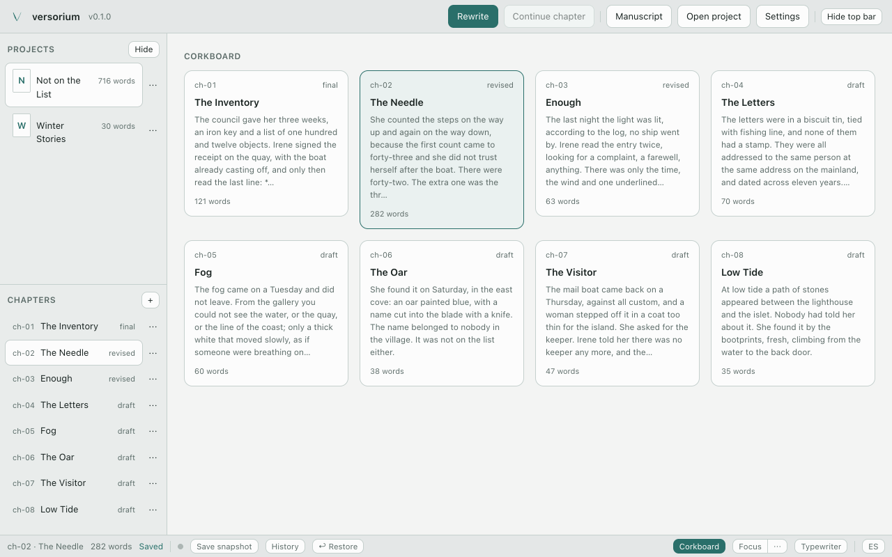
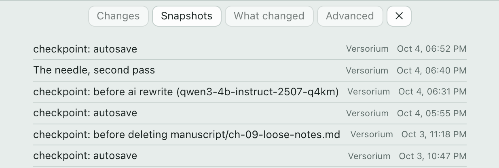
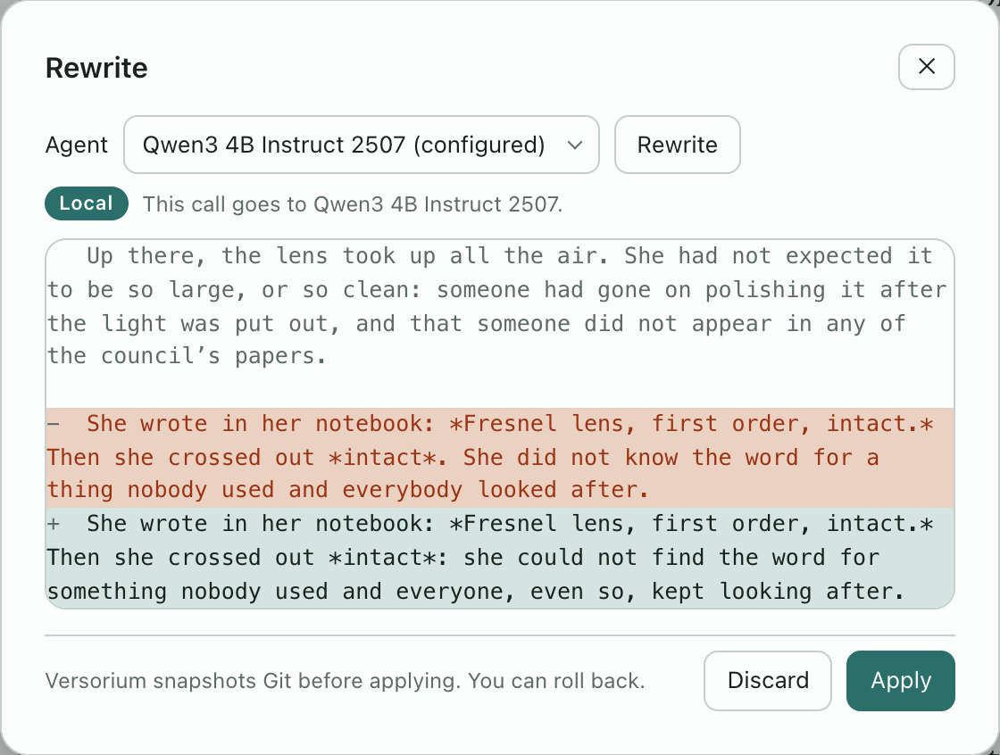

<p align="center">
  <a href="https://versorium.maecly.com/en/"></a>
</p>

<h1 align="center">Versorium</h1>

<p align="center">
  <b>Write your novel. Every draft is kept.</b><br>
  A novel-writing app for your own computer. It works offline, and AI stays off until you call it.
</p>

<p align="center">
  <a href="https://github.com/MAECLY/versorium-app/releases/latest"></a>
  <a href="https://github.com/MAECLY/versorium-app/releases"></a>
  <a href="https://github.com/MAECLY/versorium-app/stargazers"></a>
  <a href="https://hits.sh/github.com/MAECLY/versorium-app/"></a>
  <a href="https://github.com/MAECLY/versorium-app/commits/main"></a>
  <a href="LICENSE"></a>
</p>

<p align="center">
  <a href="https://github.com/MAECLY/versorium-app/releases/latest"><b>Download</b></a> ·
  <a href="https://versorium.maecly.com/en/">Website</a> ·
  <a href="https://versorium.maecly.com/en/compare/">Compare</a> ·
  <a href="https://versorium.maecly.com/en/details/">Limits</a> ·
  <a href="#for-developers">Build from source</a> ·
  <a href="README.es.md">Español</a>
</p>

<p align="center">
  <sub>Free · No account · Open source · macOS, Windows and Linux · English and Spanish</sub>
</p>

<p align="center">
  <a href="https://versorium.maecly.com/en/">
    <picture>
      <source media="(prefers-color-scheme: dark)" srcset=".github/readme/en/corkboard-dark.webp">
      
    </picture>
  </a>
</p>

## Why Versorium

- **Nothing gets lost.** It saves as you type and takes a snapshot every
  minute, before any AI writes and before a chapter is deleted.
- **Yours, start to finish.** Your novel is a folder of plain Markdown files
  that open without Versorium. No account, no telemetry.
- **AI, only if you call it.** Off, a model on your computer, or the Claude
  Code, Codex or OpenCode you already use. You see every change before it
  applies.

If Versorium disappears tomorrow, your novel doesn't.

## Download

Take the file for your computer from the
**[latest release](https://github.com/MAECLY/versorium-app/releases/latest)**.
The [website](https://versorium.maecly.com/en/#download) can also pick it for
you.

| Computer | File | Tried |
|---|---|---|
| Mac with Apple silicon, macOS 10.15+ | `.dmg` | Yes (0.1.1) |
| Mac with an Intel processor, macOS 10.15+ | `.dmg` | Not yet |
| Windows, x64 | `.exe` installer or `.msi` | Both, on Windows 11 (0.1.0), then the in-app update to 0.1.1 |
| Linux, x64 | `.deb`, `.rpm` or `.AppImage` | The `.deb`, on Ubuntu 22.04 (0.1.0) |

Each release lists a `SHA256SUMS` file. To hear about new releases: **Watch →
Custom → Releases** on this page, or the
[RSS feed](https://github.com/MAECLY/versorium-app/releases.atom).

> [!WARNING]
> The builds are not signed with an Apple or Microsoft certificate yet, so
> macOS and Windows warn you the first time. Only follow these steps for a file
> you took from this repository's releases.

<details>
<summary><b>macOS says the app is damaged.</b> It isn't.</summary>

<br>

macOS quarantines apps without an Apple Developer ID. Move Versorium to
Applications, then clear the flag once in Terminal:

```bash
xattr -rd com.apple.quarantine /Applications/Versorium.app
```

That flag is the check that protects you from a tampered download.

</details>

<details>
<summary><b>Windows shows "Windows protected your PC".</b></summary>

<br>

Choose **More info**, then **Run anyway**. Versorium needs an x86-64-v2
processor (SSE4.2) and Vulkan (`vulkan-1.dll`, normally installed with the
graphics drivers); a PC without Vulkan drivers hasn't been tried.

</details>

<details>
<summary><b>Linux</b></summary>

<br>

Mark the AppImage executable (`chmod +x`) if your file manager has not. The
`.deb` depends on `libvulkan1` and `libssl3`. Versorium needs an x86-64-v2
processor (SSE4.2).

</details>

## Nothing gets lost

Versorium saves as you type. Every minute when something changed, before an AI
writes anything and before a chapter is deleted, it takes a snapshot. Deleted a
sentence this session? **↩ Restore** brings it back in one press.

Snapshots are Git commits, made by Git built into the app: you don't install
it, and you don't need to know it to write.

<p align="center">
  <picture>
    <source media="(prefers-color-scheme: dark)" srcset=".github/readme/en/history-dark.webp">
    
  </picture>
</p>

> [!NOTE]
> Going back to an old snapshot needs Git, for now. There is no screen for it in the app yet.

## Yours, start to finish

- **A folder on your disk.** One Markdown file per chapter, scenes as `##`
  headings.
- **A record of who wrote what.** Every insert and delete is logged in the
  novel's folder with its author: you, or the AI that made it.
- **Backups you can trust.** One click writes a zip of the whole novel, history
  included, to up to three folders. Each zip is read back and checked, and a
  restore is unpacked beside your novel, never over it.
- **No account, no telemetry.** On its own, the app only checks for updates,
  once at launch, with nothing from your novel, and Settings → Application
  turns that off. An update installs only if its signature matches the key
  built into the app and its SHA-256 matches the release's `SHA256SUMS`;
  updating from inside the app has been tried end to end, from 0.1.0 to 0.1.1,
  on an Apple silicon Mac and on Windows 11.

## AI, only if you call it

It is off until you choose one, and it writes nothing without your permission.
Every rewrite shows the change first, and Versorium takes a snapshot before
applying it.

| Level | What runs | Where your passage goes |
|---|---|---|
| **Off** | Nothing | Nowhere |
| **On your computer** | A model inside the app (llama.cpp, 11 writing models, downloaded only when you ask), Ollama, or a local server such as LM Studio | Stays on your computer. A server you point at another machine is labelled Network |
| **Your tool** | The Claude Code, Codex or OpenCode you already have installed and signed in. Rewrite only | To that tool's own service |

Today the AI rewrites passages and, with a model on your computer, checks
continuity. Versorium is also an [MCP server](#mcp), so the assistants you
already use can read your manuscript, read-only unless you allow more.

<p align="center">
  <picture>
    <source media="(prefers-color-scheme: dark)" srcset=".github/readme/en/rewrite-dark.webp">
    
  </picture>
</p>

## A desk built for writing

| Feature | What it does |
|---|---|
| **Corkboard** | The whole novel at a glance, one card per chapter |
| **Focus and Typewriter** | Just you and the page; the line you write stays at the lower third |
| **Rewrite** | See every change before you apply it |
| **Themes** | Folio, Quarry and Needle, each light and dark (the pictures here are Needle) |
| **Writing** | Spell check, text size and width, templates, English and Spanish |
| **Export** | Manuscript-format DOCX, EPUB 3, PDF, Markdown and Scrivener |
| **Import** | Markdown, DOCX, EPUB and Scrivener, with a preview before anything is created |

## What it doesn't do yet

Versorium is young, and says so plainly:

- The AI only rewrites passages and checks continuity. Continuity reads chapter
  titles, scene headings and the first lines of your Codex entries, not your chapters,
  and runs only on a model you run yourself (in the app, Ollama or a local
  server), not on Claude Code, Codex or OpenCode. There is no chat.
- Going back to a snapshot needs Git, and backups are made by hand.
- Spell check uses your system's checker: it works on macOS and Windows, and
  underlines nothing on Linux yet.
- Importing from Word, EPUB or Scrivener loses bold, italics and scenes.
- Not tried yet: Intel Macs, the `.rpm`, the AppImage, and any release after
  0.1.0 on Linux.
- The builds are unsigned (see above).

Every known limit, with what was and wasn't tried, is on the
[details page](https://versorium.maecly.com/en/details/#limits).

## How it compares

Versorium is free, works offline with no account, keeps your novel in your own
Markdown files with a snapshot every minute, and lets you choose your AI or
none. Others are ahead on syncing devices, writing with other people, phone
apps, and going back to a version inside the app.

The [full comparison](https://versorium.maecly.com/en/compare/) with Dabble,
Notion, Novelcrafter, Scrivener and Sudowrite gives prices and sources, dated.

## FAQ

<details>
<summary><b>Does my novel leave my computer?</b></summary>

<br>

Only when you ask: sending it to GitHub, rewriting with an outside tool or a
server on another machine, letting an assistant read it over MCP, or backing
it up to a synced folder. On its own, the app only checks for updates, with
nothing from your novel, and you can turn that off.

</details>

<details>
<summary><b>Do I need an account, or Git?</b></summary>

<br>

No account: there's no sign-up. And you don't need Git to write: Versorium
takes the snapshots for you, with Git built in. For now, Git is only needed to
go back to an old snapshot.

</details>

<details>
<summary><b>Which AI does it use?</b></summary>

<br>

None until you choose one: a model inside the app itself, Ollama or a local
server, or Claude Code, Codex or OpenCode, which send the passage to their own
service.

</details>

<details>
<summary><b>Can I bring my novel from Scrivener or Word?</b></summary>

<br>

Yes: it imports Scrivener, DOCX, EPUB and Markdown, and shows you a preview
before creating anything. From DOCX, EPUB or Scrivener, bold, italics and
scenes are lost.

</details>

<details>
<summary><b>Why is it free?</b></summary>

<br>

It's open source (AGPL-3.0) and made by one person. There's no paid tier and
no ads, and the app collects no data.

</details>

## Why it exists

> I made Versorium for myself. I wanted to write calmly, never afraid of losing a page, with AI on my terms or not at all. The apps I tried fell short for novels or charged too much. So it's free and open source: your novel lives in a folder you own, every change is kept, and AI (the one you already pay for, one on your computer, or none) only steps in when you call it. I keep improving it.
>
> — Miguel Angel Esparza Calero, [maecly.com](https://www.maecly.com/about)

## Contributing

You don't need to code to help.

- **Try it on an Intel Mac, or the `.rpm` or AppImage on Linux**, and
  [open an issue](https://github.com/MAECLY/versorium-app/issues) saying what
  happened.
- **Report a bug** from inside the app: in Settings, the crash report's
  **Report**, then **Open an issue**, opens a prefilled issue in your browser,
  with no novel text in it.
- **Improve the English or Spanish** in [`locales/`](locales).
- **Send a fix.** Read [CONTRIBUTING.md](CONTRIBUTING.md) and agree to the
  [Contributor License Agreement](CLA.md); you keep the copyright in what you
  write. Run `make verify` before you open the pull request.

What is planned next is in [docs/project/TODO.md](docs/project/TODO.md). If
Versorium is useful to you, a star helps other writers find it.

## For developers

**Stack:** Tauri 2 · Rust · Svelte 5 · CodeMirror 6 · libgit2 · llama.cpp

You need stable Rust, Node `^20.19` or `>=22.12`, pnpm (pinned in
`package.json`), and cmake with a C/C++ toolchain, because llama.cpp is
compiled from source. Linux also needs the packages CI installs (listed in
[`ci.yml`](.github/workflows/ci.yml)).

```bash
pnpm install
make dev PNPM=pnpm             # the desktop app, with hot reload
make mock PNPM=pnpm            # the interface in a browser, backend stubbed
make verify PNPM=pnpm          # every check: types, locales, UI, Rust, clippy, end-to-end
pnpm tauri build --no-sign     # installable bundles, without the maintainer's updater key
```

<details>
<summary><b>Notes for Windows and for the end-to-end tests</b></summary>

<br>

The Makefile expects a POSIX shell and defaults to Homebrew's pnpm on Apple
silicon, hence `PNPM=pnpm`. On Windows, run the scripts directly:
`pnpm tauri dev`, then `pnpm check`, `pnpm locales`, `pnpm test:ui`,
`pnpm test:e2e`, and `cargo test` / `cargo clippy --all-targets -- -D warnings`
in `src-tauri/`. The end-to-end tests run in Google Chrome; set
`PLAYWRIGHT_CHANNEL` to use another Playwright browser. `make help` lists every
target.

</details>

### MCP

Versorium's own binary is an MCP server over stdio, **read-only by default**.
Settings → Access to your novel connects Claude Code, Claude Desktop, Codex and
OpenCode for you and shows the exact command. Writing needs a grant per
client. A write without `confirm: true` only returns a diff preview, and an
applied write is preceded by a Git snapshot and logged under the client's
name. An optional HTTP transport is off by default and listens on
`127.0.0.1` only.

### Documentation

| Read | For |
|---|---|
| [docs/project/REFERENCE.md](docs/project/REFERENCE.md) | The developer reference: the rules the project keeps, build commands, agents, the MCP tools, a novel's layout on disk |
| [AGENTS.md](AGENTS.md) | How the code is laid out, and the conventions it follows |
| [docs/project/](docs/project/) | The spec, the design system, status, the to-do list and how releases are made |
| [versorium.maecly.com](https://versorium.maecly.com/en/) | The website (its source is in a private repository) |

## License

Versorium is free software under the
[GNU Affero General Public License v3.0](LICENSE). Contributions are accepted
under the [CLA](CLA.md). The name, the wordmark and the mark belong to MAECLY
and are not covered by that licence; see [TRADEMARKS.md](TRADEMARKS.md).
Bundled third-party licences: [THIRD-PARTY-NOTICES.md](THIRD-PARTY-NOTICES.md).
For a commercial licence, write to hola@maecly.com.

<p align="center">
  <sub><em>A quiet desk, a sharp needle.</em><br>
  Made by <a href="https://www.maecly.com/about">Miguel Angel Esparza Calero</a> · <a href="https://versorium.maecly.com/en/">versorium.maecly.com</a></sub>
</p>
